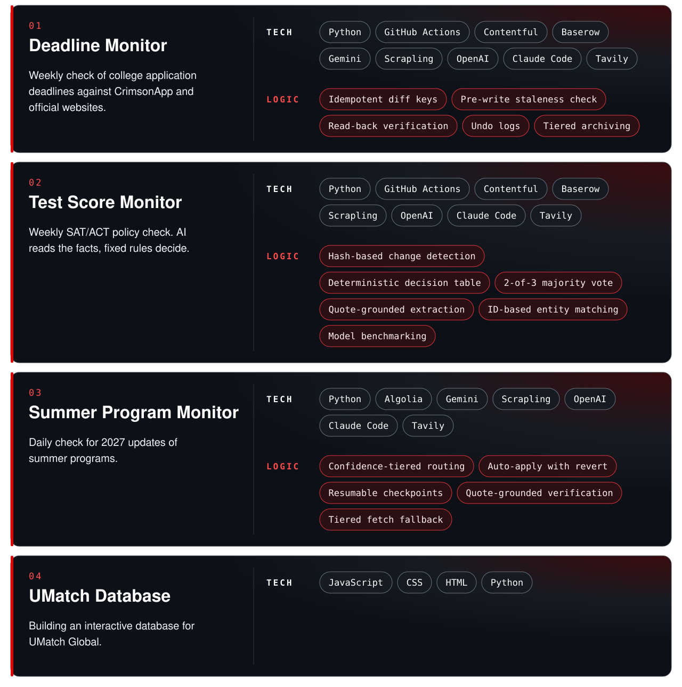
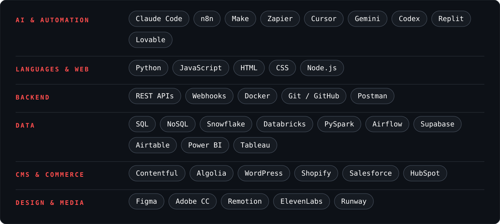
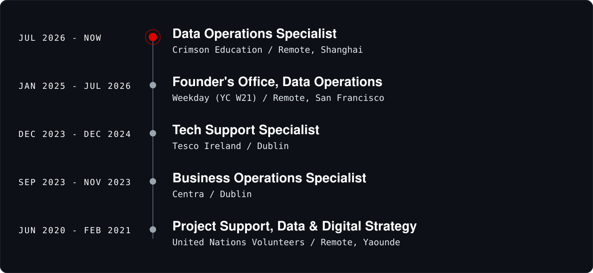
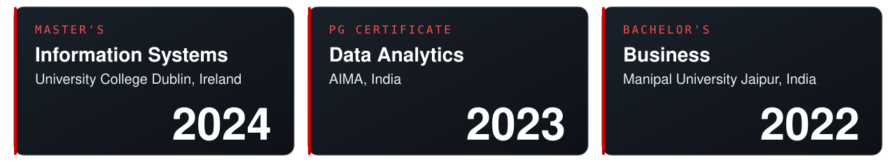

<div align="center">




</div>

---

## About

```text
$ whoami
pritam, data operations specialist

$ cat about.txt
3+ years automating real operations, from a YC-backed startup
to one of Ireland's biggest retailers. Now building the data
engine behind Crimson Education.

$ cat philosophy.txt
Humans decide. Machines do the doing.
Automate the boring. Keep the judgement calls.
Nothing goes to production without a human saying yes.
```

---

## Here at Crimson

<div align="center"></div>


---

## Tech Stack

<div align="center"></div>

---

## Experience

<div align="center"></div>

---

## Education

<div align="center"></div>
