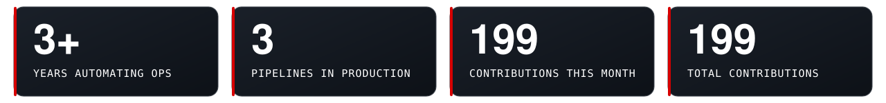
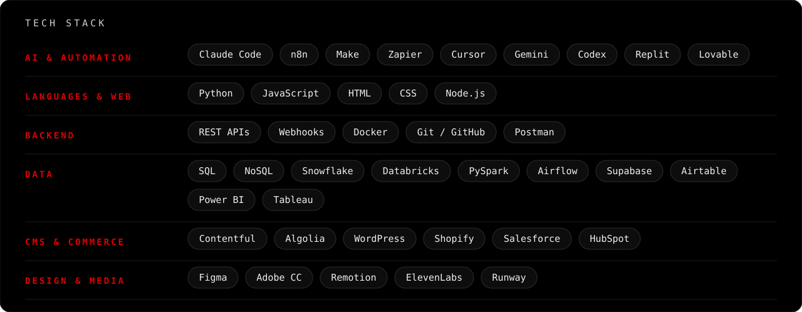
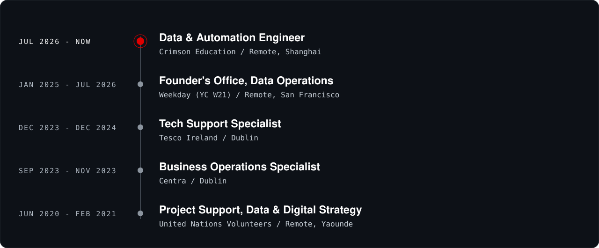
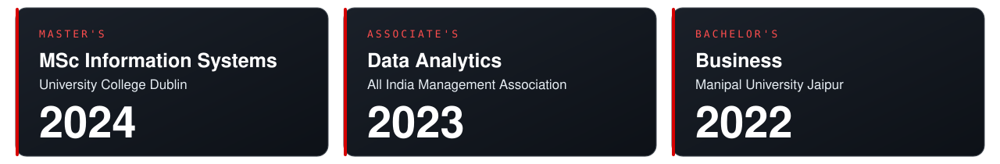

<div align="center">



[](https://pritamlaskar.github.io/)
[](https://github.com/crimson-education)



</div>

---

## About

```text
$ whoami
pritam, data & automation engineer

$ cat about.txt
3+ years automating real operations, from a YC-backed startup
to one of Ireland's biggest retailers. Now building the data
engine behind Crimson Education.

$ cat philosophy.txt
Humans decide. Machines do the doing.
Automate the boring. Keep the judgement calls.
Nothing goes to production without a human saying yes.
```

---

## Here at Crimson

| Project | What it does | Stack |
|---|---|---|
| **Deadline Monitor** | Weekly check of college application deadlines against the CMS. Mismatches go to review, approved rows get pushed live. | **Tech:** Python, GitHub Actions, Contentful, Baserow, Gemini<br/><br/>**Logic:** Idempotent diff keys, pre-write staleness check, read-back verification, undo logs, tiered archiving |
| **Test Score Monitor** | Weekly SAT/ACT policy check. AI reads the facts, fixed rules decide. | **Tech:** Python, GitHub Actions, Contentful, Baserow, LLMs<br/><br/>**Logic:** Hash-based change detection, deterministic decision table, 2-of-3 majority vote, quote-grounded extraction, ID-based entity matching, model benchmarking |
| **Summer Program Monitor** | Daily check for 2027 dates and tuition. Extract, verify and validate with confidence routing. Review only. | **Tech:** Python, Scrapling, Algolia, Gemini<br/><br/>**Logic:** Confidence-tiered routing, auto-apply with revert, resumable checkpoints, quote-grounded verification, tiered fetch fallback |
| **UMatch Database** | Building an interactive database for UMatch Global. | **Tech:** JavaScript, CSS, HTML, Python |

*Source is private (company code).*

---

## Tech Stack

<div align="center"></div>

---

## Experience

<div align="center"></div>

---

## Education

<div align="center"></div>
